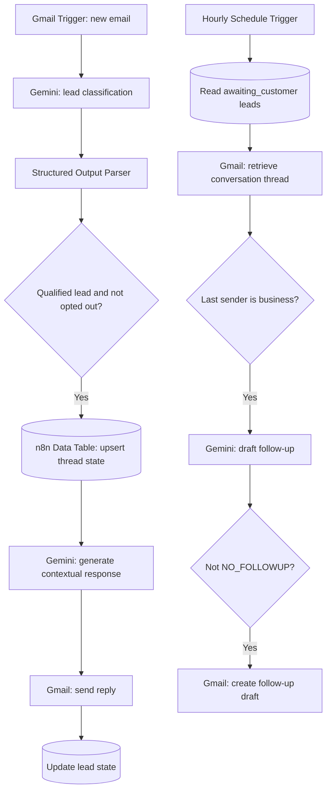

# FollowUpOS — AI-Powered Lead Capture & Follow-Up

**FollowUpOS** is a two-workflow n8n automation that qualifies inbound sales inquiries with Gemini, stores lead state in an n8n Data Table, generates contextual Gmail replies, and prepares follow-up drafts for human review.

> **Status:** Exported workflow prototype. Both workflows are inactive in the supplied exports. Configuration and testing are required before use.

## Architecture

## Features

- Gmail polling trigger for inbound messages.
- Gemini-based lead qualification, buying-intent classification, and structured JSON output.
- Lead state persisted in n8n Data Tables, keyed by Gmail thread ID.
- Contextual **automatic email replies** for qualified inquiries.
- Scheduled examination of leads awaiting a customer response.
- Gemini-generated follow-up **drafts**, not automatically sent follow-ups.
- Prompts instruct agents to avoid fabricated commitments, opt-outs, and email-borne prompt injection.

## Workflow exports

| File | Purpose |
| --- | --- |
| `workflows/01-lead-capture-auto-reply.json` | Polls inbox, qualifies leads, persists state, sends an initial reply, updates state |
| `workflows/02-follow-up-draft-agent.json` | Periodically reviews waiting leads and creates Gmail follow-up drafts |

## Stack

**n8n**, **Google Gemini**, **Gmail OAuth2**, **n8n Data Tables**, **n8n LangChain AI Agent**, **Structured Output Parser**.

## Getting started

1. Create or open an n8n instance that supports Data Tables and the required AI/Gmail nodes.
2. Import both workflow JSON files from the `workflows/` folder.
3. Connect your own Gmail OAuth2 and Google Gemini credentials in the imported nodes.
4. Create an n8n Data Table named `followupos_leads` with the fields below.
5. In every Data Table node, replace `REPLACE_WITH_YOUR_DATA_TABLE_ID` by selecting your table.
6. In the follow-up workflow's first **If** node, replace `YOUR_BUSINESS_EMAIL@example.com` with the mailbox sending business replies.
7. Review the Gmail Trigger polling schedule, the follow-up schedule, and all AI prompts.
8. Use a dedicated test inbox and sample emails before enabling either workflow.

### Data Table schema

| Column | Suggested type |
| --- | --- |
| `thread_id` | String |
| `customer_email` | String |
| `customer_name` | String |
| `company_name` | String |
| `service_interested` | String |
| `buying_intent` | String |
| `lead_status` | String |
| `last_activity_at` | DateTime |
| `last_sender` | String |
| `next_followup_at` | DateTime |
| `followup_count` | Number |

## Important limitations / review before production

- **Initial replies are sent automatically.** If you want human approval, replace the Gmail *Reply to a message* node with a draft/review step.
- **No real follow-up waiting period is currently enforced.** The follow-up workflow checks `hours_since_last_message >= 0`, so it can draft immediately on the next hourly run. Set a meaningful threshold (e.g., 48 hours) and/or compare against `next_followup_at`.
- `next_followup_at` is currently written as the current time in the lead-capture workflow, rather than a future deadline.
- A follow-up draft does **not** update the lead record, increment `followup_count`, or prevent another draft next hour. Add a cooldown and draft-state tracking to avoid duplicates.
- There is no explicit maximum follow-up count or verified global suppression list; prompt instructions alone should not be treated as enforcement.
- The lead-capture workflow runs based on incoming Gmail-triggered messages. Add safeguards to exclude outgoing, self-sent, and duplicate messages before production activation.
- Prompt-level constraints are not equivalent to programmatic security or output validation.

## Privacy and safe publishing

These public example exports have credential references, instance metadata, webhook IDs, original Data Table identifiers, and a hard-coded mailbox address removed or replaced. **Do not commit actual emails, OAuth credentials, execution histories, or `.env` files.** Importing requires reconnecting your own accounts and table.

## Notes

This repository showcases n8n workflow design and integration logic, not a production-ready autonomous sales system. Validate every trigger, branch and output with controlled test data before enabling workflows on a real inbox.
